# Última Notificación

**Videojuego de terror psicológico para promover el uso saludable de las redes sociales.**
Proyecto final de Programación Orientada a Objetos y Estructura de Datos · **PowerGames** · Universidad del Norte.

Hecho **100 % en Java, desde cero y sin motores gráficos** (nada de Unity ni Godot): el 3D, las texturas, los sonidos y las estructuras de datos están programados a mano.

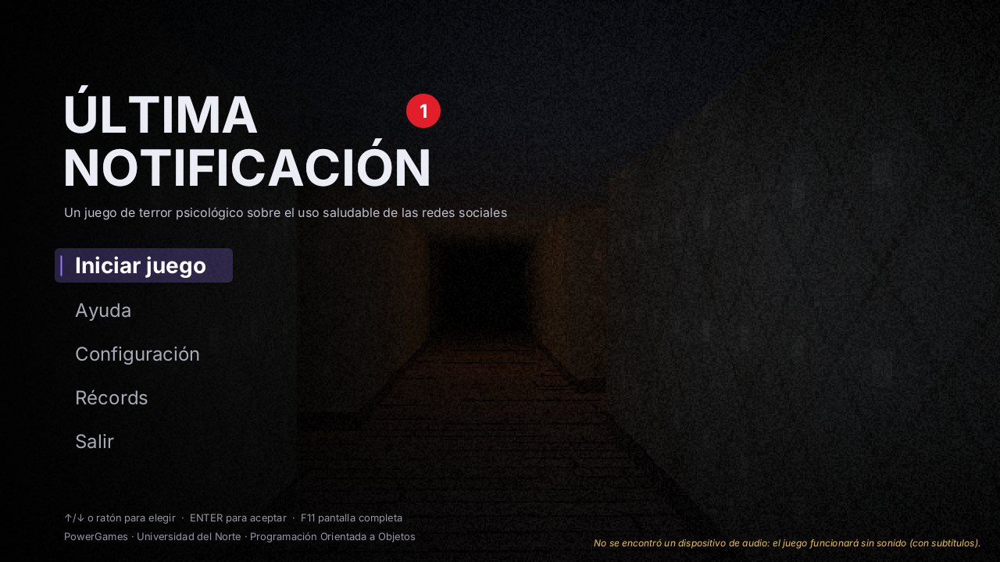

---

## La historia

Eres un adolescente que pasa tres noches solo en casa: tu mamá trabaja de noche en el hospital. Antes de dormir solo vas a "revisar el teléfono un momento" en **eco**, una red social ficticia.

Cada publicación, mensaje y notificación te obliga a decidir: seguir desplazándote, compararte, responder con rabia... o silenciar, reportar, hablar con alguien de confianza y cerrar la app. Tus decisiones cambian tu **sueño, autoestima, ansiedad, concentración y relaciones**. Cuando caes en malos hábitos, la tensión sube, la interfaz se distorsiona y algo empieza a moverse por la casa: **@tu_seguidor**.

Si a las **3:12 a. m.** sigues despierto, llega la última notificación.

| | |
|---|---|
| 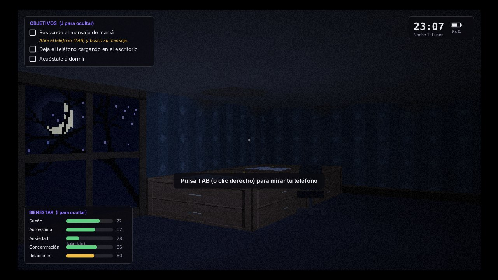 | 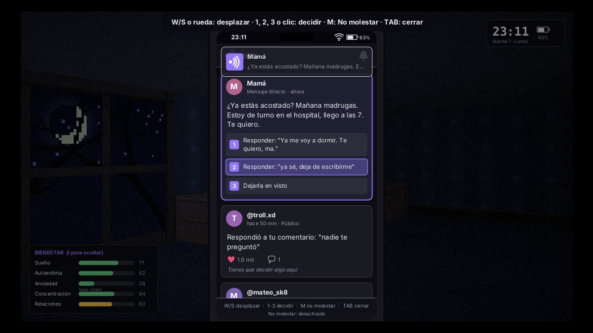 |
| 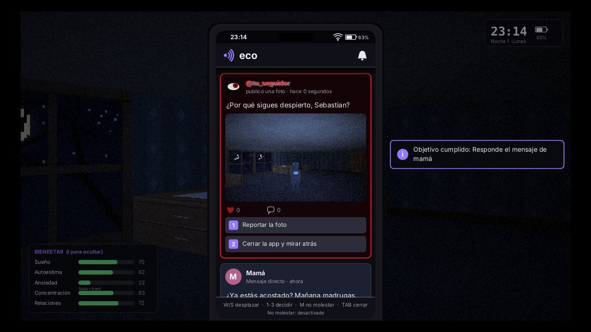 | 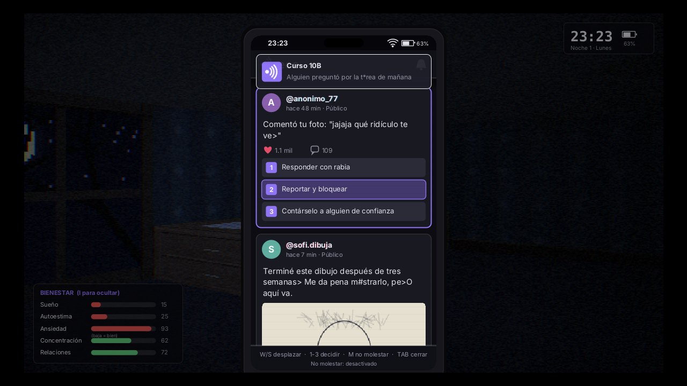 |
| 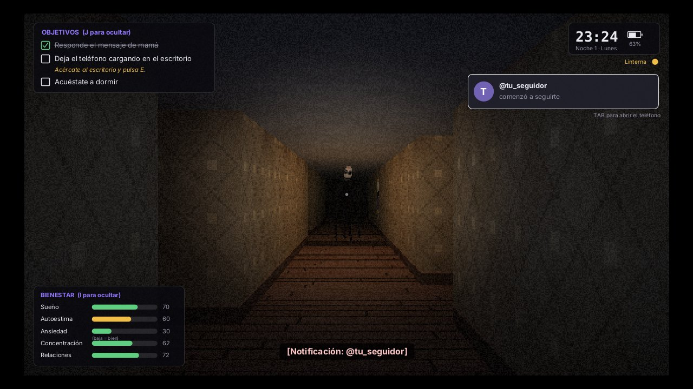 | 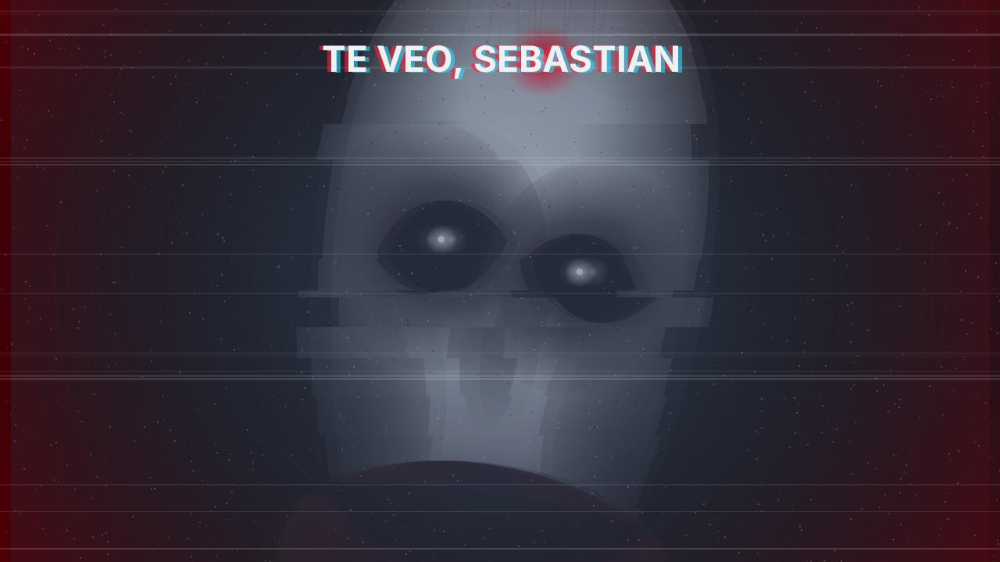 |
| 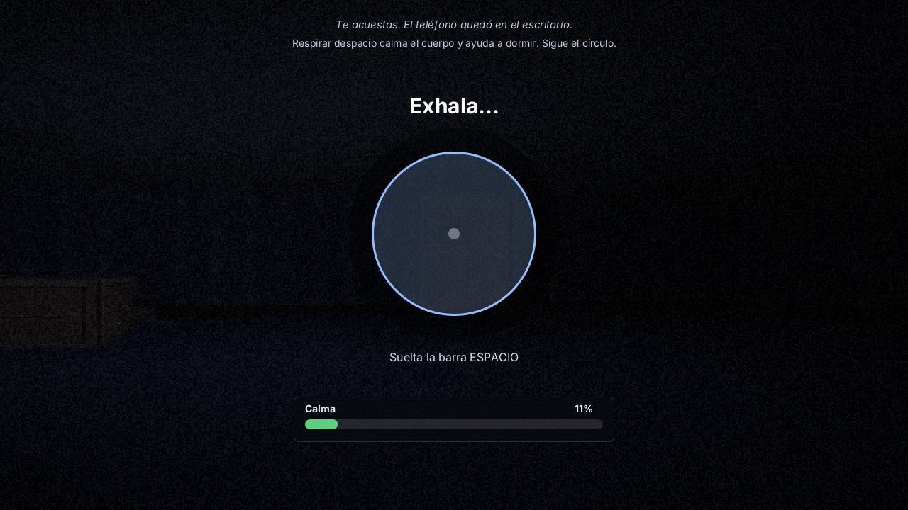 | 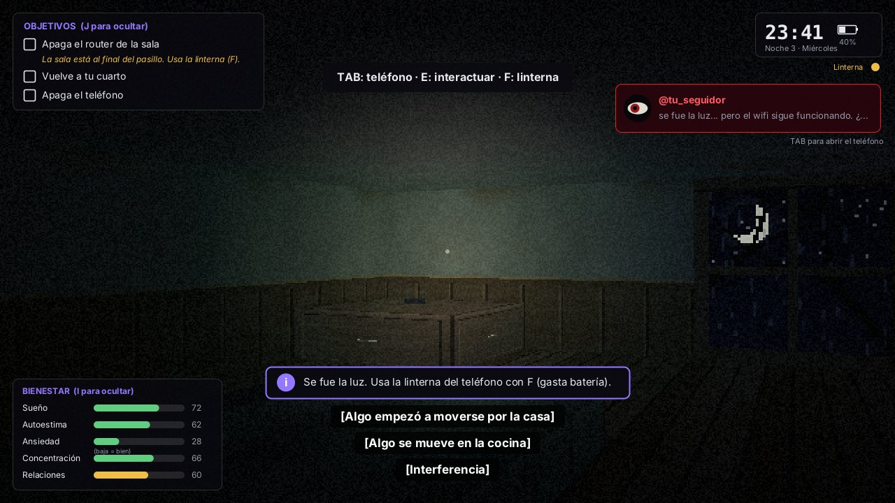 |
| 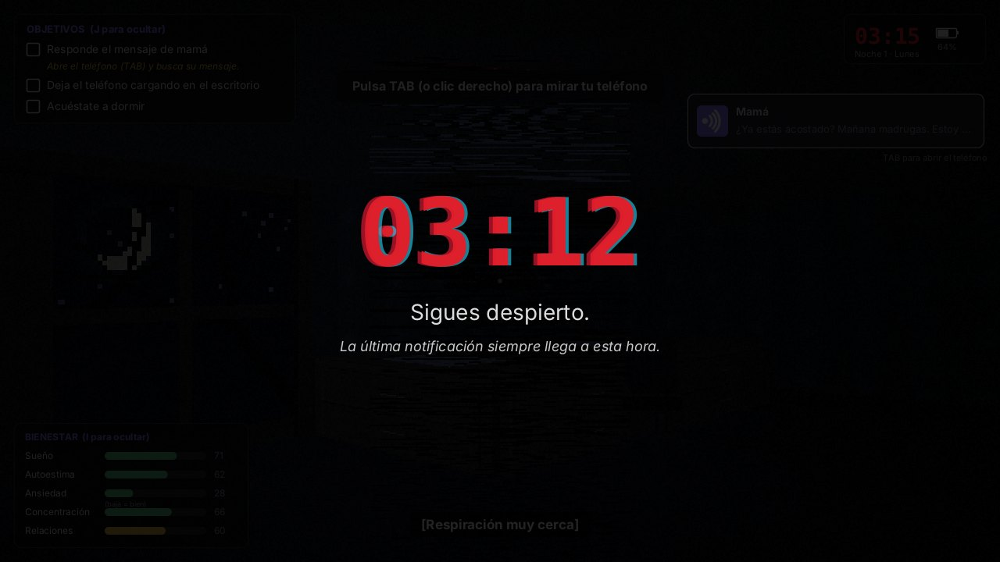 | 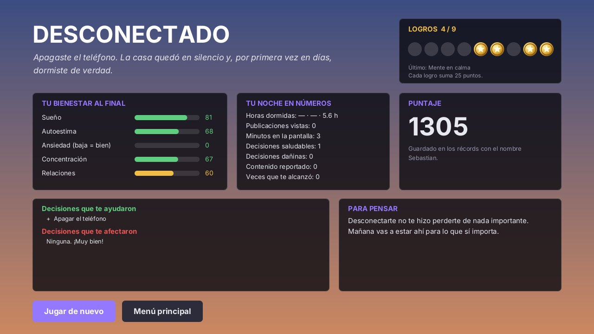 |
| 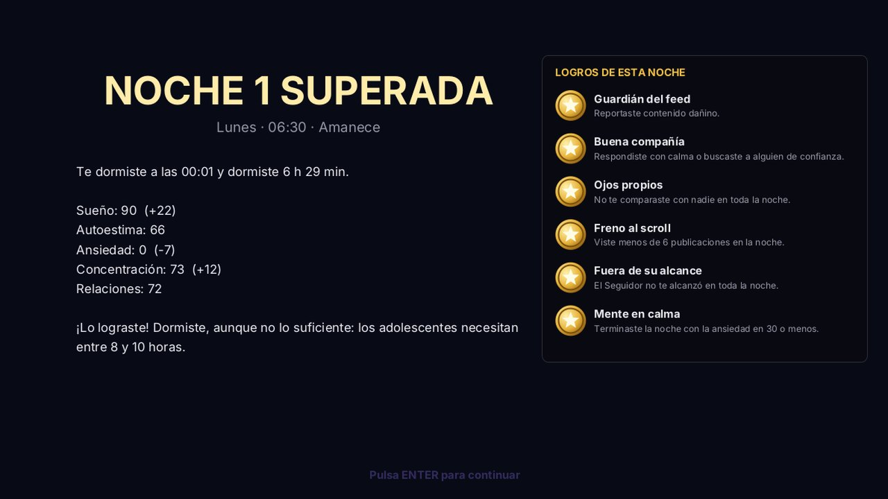 | 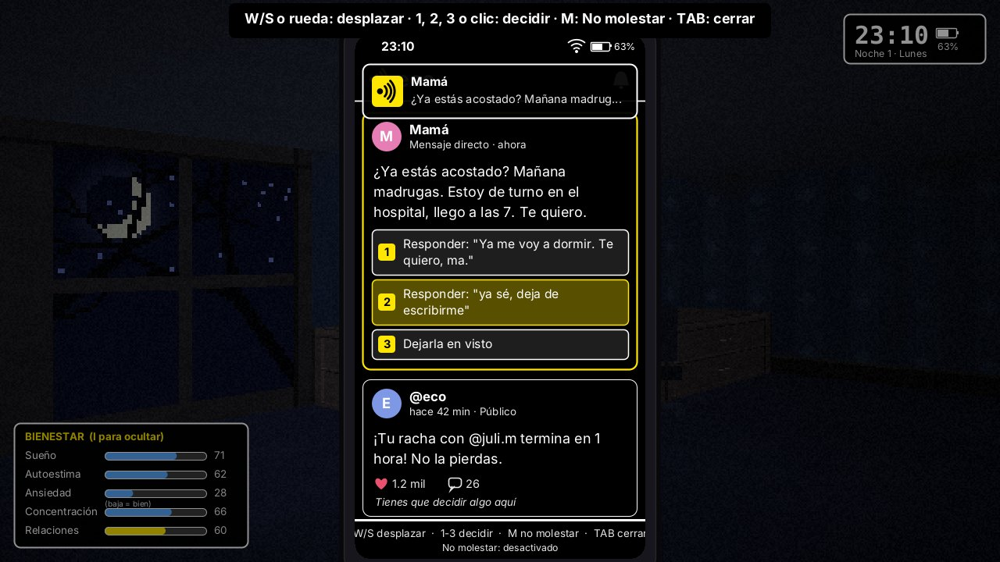 |

---

## Cómo ejecutarlo

### Requisitos
- **JDK 17 o superior** (recomendado [Eclipse Temurin 21](https://adoptium.net/)). Comprueba con `java -version`.
- **Visual Studio Code** con la extensión **Extension Pack for Java** (`vscjava.vscode-java-pack`). VS Code la recomienda automáticamente al abrir la carpeta.
- Audífonos (opcional, pero el sonido es la mitad del miedo).

### Descargar el proyecto
```bash
git clone https://github.com/oreo0309/Last-Notification.git
cd Last-Notification
```

### En VS Code
1. `Archivo → Abrir carpeta…` y elige la carpeta del proyecto (`Last-Notification`).
2. Espera a que la extensión de Java termine de cargar el proyecto (abajo a la izquierda).
3. Ve a **Ejecutar y depurar** (`Ctrl+Shift+D`), elige **"Jugar: Última Notificación"** y pulsa **F5**.
4. Para correr las pruebas, elige **"Pruebas (estructuras de datos y lógica)"**.

También puedes usar `Terminal → Ejecutar tarea…` → **Jugar**, **Compilar** o **Pruebas**.

### Desde la terminal
```bat
:: Windows
ejecutar.bat      :: compila y abre el juego
probar.bat        :: compila y corre las 97 pruebas
```
```bash
# Linux / macOS
./ejecutar.sh
./probar.sh
```

---

## Controles

| Acción | Tecla |
|---|---|
| Caminar | `W A S D` o flechas · `SHIFT` para correr |
| Mirar | Ratón (o `←` `→`) |
| Abrir / cerrar el teléfono | `TAB` o clic derecho |
| Desplazar el feed | `W` / `S`, `↑` / `↓` o rueda del ratón |
| Decidir | `1`, `2`, `3` o clic en la opción |
| Activar "No molestar" | `M` (con el teléfono abierto) |
| Interactuar (puertas, cama, escritorio, router…) | `E` |
| Linterna del teléfono (gasta batería) | `F` |
| Respirar (en la cama) | Mantener / soltar `ESPACIO` siguiendo el círculo |
| Objetivos / bienestar | `J` / `I` |
| Pausa · Ayuda · Pantalla completa · FPS | `ESC` · `F1` · `F11` · `F9` |

---

## Cómo se juega

- **Tres noches** (lunes, martes y miércoles), cada una con objetivos: responder a mamá, dejar el teléfono cargando lejos de la cama, activar "No molestar", reportar el reto peligroso #RetoNoDormir, cerrar la puerta, apagar el router en plena tormenta…
- **El tiempo corre**, y corre más rápido cuando miras el teléfono. Cada publicación nueva que ves te cuesta minutos de sueño (el *scroll infinito* nunca termina).
- **La tensión** sale de tu bienestar, de cuántas publicaciones llevas seguidas y de la hora. Al subir, el feed se corrompe, aparecen publicaciones que no deberían existir (como una foto tuya tomada desde atrás), las luces parpadean, se escuchan pasos y susurros…
- **El Seguidor**: si lo miras, no se mueve. Mientras miras el teléfono, no lo estás mirando a él. La linterna lo hace retroceder. Las buenas decisiones bajan la tensión y lo alejan. Si te alcanza, pierdes tiempo y bienestar.
- **Dormir**: deja el teléfono en el escritorio, acuéstate y respira al ritmo del círculo hasta llenar la barra de calma.
- **Logros**: al terminar cada noche ganas medallas por hábitos saludables (*Desconexión a tiempo*, *Sueño reparador*, *Guardián del feed*, *Buena compañía*, *Ojos propios*, *Freno al scroll*, *Modo noche*, *Fuera de su alcance*, *Mente en calma*), con sonido de "noche superada". Cada logro suma puntos para los récords.
- **Cuatro finales**: *Desconectado*, *Al límite*, *Ahora eres contenido* y *La última notificación* (3:12 a. m.). La pantalla de resultados muestra tu bienestar, tus números de la noche, tus mejores y peores decisiones y un mensaje para reflexionar.

---

## Cumplimiento del documento del proyecto (POO 2026-30)

| Requisito del documento | Cómo lo cumple el juego |
|---|---|
| Lenguaje Java o Python | Java 17+, sin motores ni librerías externas |
| Juego de creación propia, orientado al usuario (población objetivo) | Historia y mecánicas propias; dirigido a adolescentes de 12 a 17 años (y a docentes o familias) |
| Objetivo y mecánica definidos | Sobrevivir 3 noches cumpliendo objetivos y dormir antes de las 3:12 a. m.; 1 jugador; puntaje, logros y récords |
| Enfoque en el uso saludable de redes **sin preguntas explícitas** | Se aprende con decisiones y consecuencias dentro de una red social simulada (no hay cuestionarios) |
| a. Componente **aleatorio** y componentes que dependen de la **habilidad** | Aleatorio: publicaciones, notificaciones, eventos de terror, apariciones y momentos de cada susto. Habilidad: esquivar al Seguidor (mirarlo, linterna, rutas), administrar tiempo y batería, respirar al ritmo para dormir, tomar buenas decisiones |
| b. Componente **inclusivo** | Subtítulos de todos los sonidos importantes (limitación auditiva), sonido posicional, alto contraste, filtros para daltonismo, reducción de sustos y destellos, volumen, brillo y sensibilidad configurables |
| c. Mínimo **7 clases propias** y **2 patrones** (no Singleton/Prototype/Module) + **SOLID** | 73 clases, interfaces y enumeraciones propias; patrones **State** y **Factory Method** (además, el teléfono avisa a la partida mediante una interfaz oyente, al estilo Observer); ver sección SOLID |
| d. Todo se muestra de forma **gráfica** | Ventana gráfica 3D + interfaz del teléfono, HUD, menús y resultados |
| Usabilidad i. Herramienta de **ayuda** | `PantallaAyuda` (F1 o desde el menú): objetivo, controles, bienestar, El Seguidor, consejos, créditos |
| Usabilidad ii. **Mensajes de ayuda** dentro del juego | Pistas de cada objetivo, indicaciones de teclas en contexto, mensajes de orientación tras cada decisión |
| Usabilidad iii. Elementos **motivadores** | Sonidos y efectos al decidir bien, "Objetivo cumplido", pantalla de **noche superada** con música, **logros con medallas**, puntaje y récords, mensajes motivadores |
| Usabilidad iv. **Prueba con 5 usuarios** | Formulario listo en `docs/formulario_usabilidad.md` (la aplica el equipo) |
| Confiabilidad: sin errores, retos bien diseñados, **entradas erradas** | Probado de principio a fin sin errores; validación de nombre, archivos dañados ignorados, errores registrados en `datos/errores.log` sin cerrar el juego |
| Rúbrica: **sin errores ni advertencias de compilación** | Compila sin advertencias con `javac -Xlint:all` |

## Requerimientos funcionales del informe

| RF | Requerimiento | Dónde está |
|---|---|---|
| RF1 | Menú con iniciar, ayuda, configuración y salir | `PantallaMenu` (además: Récords) |
| RF2 | Interfaz inspirada en una red social ficticia | App **eco** dentro del teléfono: `InterfazTelefono`, tarjetas en `ElementoBase` |
| RF3 | Publicaciones y notificaciones aleatorias | `FabricaPublicacion`, `FabricaNotificacion`, `FabricaEventoTerror` (con pesos según noche y tensión) |
| RF4 | Decisiones frente a cada evento | Cada `ElementoFeed` ofrece `Decision`es (teclas 1-3 o clic) |
| RF5 | Indicadores de bienestar que cambian | `IndicadorBienestar` + `Decision.aplicarEfecto()`; barras en pantalla |
| RF6 | Eventos de terror cuando sube el riesgo | `EventoTerror`, `DirectorTerror`, `ElSeguidor`, distorsión del feed y de la imagen |
| RF7 | Sección de ayuda | `PantallaAyuda` (6 páginas) |
| RF8 | Mensajes de orientación durante la partida | Mensajes tras cada decisión, pistas de objetivos, avisos del scroll infinito |
| RF9 | Opciones inclusivas | `ConfiguracionAccesibilidad`: subtítulos, alto contraste, reducción de sustos y destellos, filtros para daltonismo, volumen, brillo, sensibilidad |
| RF10 | Pantalla de resultados | `PantallaResultados` (+ récords guardados en archivo) |
| RF11 | Entradas erradas sin cerrarse | Validación del nombre, archivos dañados ignorados, errores registrados en `datos/errores.log` sin cerrar el juego |

---

## Diseño orientado a objetos

Se respetan las clases y atributos del **diagrama UML actualizado** del equipo: `Juego`, `Jugador`, `Mision`, `Decision`, `IndicadorBienestar`, `Feed`, `ElementoFeed`, `Publicacion`, `Notificacion`, `EventoTerror`, `GestorAudio`, `ConfiguracionAccesibilidad`, `Pantalla` (+ `PantallaMenu`, `PantallaFeed`, `PantallaSegura`) y `FabricaContenido` (+ sus tres fábricas).

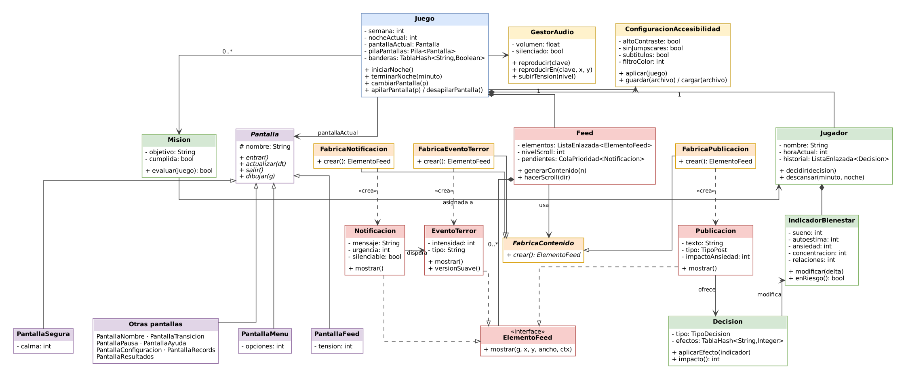

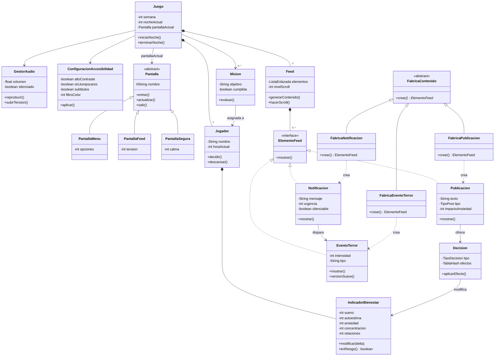

### Patrones de diseño

- **State** — `Pantalla` es el estado abstracto (`entrar()`, `actualizar()`, `salir()`, `dibujar()`) y `Juego.pantallaActual` es el contexto. Estados: `PantallaMenu`, `PantallaNombre`, `PantallaTransicion`, `PantallaFeed` (partida activa), `PantallaSegura` (descanso), `PantallaPausa`, `PantallaAyuda`, `PantallaConfiguracion`, `PantallaRecords`, `PantallaResultados`. Los estados superpuestos (pausa, ayuda, descanso) se guardan en una **pila** propia (`apilarPantalla` / `desapilarPantalla`).
- **Factory Method** — `FabricaContenido.crear()` es el método fábrica; `FabricaPublicacion`, `FabricaNotificacion` y `FabricaEventoTerror` deciden qué `ElementoFeed` concreto crear según la noche y la tensión. `Feed` trabaja solo con el tipo abstracto.

### Buenas prácticas (SOLID)

- **S — Responsabilidad única**: cada clase hace una cosa: `Renderizador3D` dibuja, `Iluminacion` calcula luz, `GestorAudio` mezcla sonido, `InterfazTelefono` dibuja el teléfono, `Hud` dibuja la información, `DirectorTerror` decide los sustos, `ElSeguidor` controla a la entidad.
- **O — Abierto/cerrado**: se agregan publicaciones, notificaciones o pantallas nuevas creando clases o plantillas, sin modificar `Feed` ni `Juego`.
- **L — Sustitución de Liskov**: cualquier `Pantalla` funciona como estado de `Juego`, y cualquier `ElementoFeed` (publicación, mensaje o evento) se muestra y se decide de la misma forma.
- **I — Segregación de interfaces**: interfaces pequeñas y específicas: `ElementoFeed`, `MapaRender` (lo único que el renderizador necesita del mapa) e `InterfazTelefono.Oyente`.
- **D — Inversión de dependencias**: `Renderizador3D` depende de la abstracción `MapaRender` (no de `Casa`) y `Feed` depende de `FabricaContenido` (no de las fábricas concretas).

---

## Estructuras de datos (implementadas desde cero)

Todo el juego usa estas estructuras propias del paquete `estructuras` (no se usan `ArrayList`, `HashMap`, etc. de Java):

| Estructura | Implementación | Uso en el juego |
|---|---|---|
| `ListaEnlazada<T>` | Doble enlace, iterable, ordenamiento por **merge sort** O(n log n) | Feed de publicaciones, historial de decisiones, misiones, sprites (ordenados por distancia para dibujarlos) |
| `Cola<T>` | Nodos enlazados, FIFO | Eventos de teclado/ratón entre hilos, subtítulos, recorrido BFS, mensajes de orientación |
| `Pila<T>` | Nodos enlazados, LIFO | Pantallas superpuestas (pausa, ayuda, descanso) del patrón State; recorrido del árbol |
| `ColaPrioridad<T>` | **Montículo binario** sobre arreglo dinámico | Notificaciones por urgencia, eventos programados de cada noche, acciones diferidas del director de terror |
| `TablaHash<K,V>` | Encadenamiento separado, redimensiona con factor de carga 0.75 | Efectos de cada `Decision`, texturas, sonidos, banderas de misión, configuración |
| `Grafo` | Listas de adyacencia + **BFS** (distancias y camino más corto) | Mapa de la casa: El Seguidor te persigue con el camino más corto; puntos de aparición ocultos |
| `ArbolBinarioBusqueda<K,V>` | ABB con recorridos en orden e inverso (con pila) | Récords ordenados por puntaje; mejores y peores decisiones en los resultados |

Las pruebas (`test/pruebas`) verifican cada estructura y la lógica del juego: **97 pruebas**.

---

## Cómo funciona el 3D (sin motor)

- **Raycasting** estilo *Wolfenstein 3D* mejorado: un rayo por columna de pantalla con el algoritmo DDA. Soporta muebles de media altura (cama, escritorio, sofá…) con tapa visible, puertas corredizas, piso y techo texturizados, inclinación de cámara y sprites con búfer de profundidad.
- **Iluminación**: luces "horneadas" por celda con línea de vista (luna por las ventanas, lámpara, luz de noche del pasillo, televisor, router) más luz dinámica de la linterna y del brillo del teléfono. Parpadeos, apagón y relámpagos.
- **Texturas procedurales**: todas generadas con ruido y dibujo por código (papel tapiz, madera, baldosas, ventanas con luna, cuadros que cambian cuando no los miras…).
- **Audio sintetizado**: vibración, notificaciones, susurros, pasos, golpes, crujidos, truenos, latidos y el grito del susto se generan matemáticamente; un mezclador propio hace sonido estéreo posicional y reverberación.
- **Postproceso**: grano, viñeta, aberración cromática y *glitch* que aumentan con la tensión.

---

## Estructura del proyecto

```
Last-Notification/
├── src/
│   ├── estructuras/        Lista, Cola, Pila, ColaPrioridad, TablaHash, Grafo, ABB
│   └── juego/
│       ├── Juego, Jugador, Mision, Decision, IndicadorBienestar, ConfiguracionAccesibilidad, Noche…
│       ├── audio/          GestorAudio, Sintetizador
│       ├── feed/           Feed, ElementoFeed, Publicacion, Notificacion, EventoTerror, fábricas
│       ├── interfaz/       Teléfono, estilos accesibles, dibujo, susto
│       ├── motor/          Ventana, Entrada, Renderizador3D, Iluminacion, texturas, efectos
│       ├── mundo/          Casa, Mundo3D, ElSeguidor, Puerta
│       └── pantallas/      Pantalla y sus estados, HUD, DirectorTerror
├── test/pruebas/           Pruebas de estructuras y lógica
├── docs/                   Diagrama UML, capturas, formulario de usabilidad
├── .vscode/                Configuración lista para VS Code
├── compilar / ejecutar / probar (.bat y .sh)
└── datos/                  (se crea al jugar: configuración, récords y registro de errores)
```

---

## Uso de herramientas de inteligencia artificial

El documento del proyecto pide declarar el uso de IA. En este proyecto se usó **Claude (Anthropic)** como asistente para generar y depurar el código Java, probar el juego de forma automatizada, generar el diagrama de clases y redactar esta documentación, a partir del concepto, los requerimientos y el diagrama UML definidos por el equipo. El equipo debe describirlo así en la sección de Metodología del informe técnico.

---

## Equipo — PowerGames

| Integrante | Rol |
|---|---|
| Sebastian Diaz | Gerente de proyecto |
| Carlos Roman | Frontend developer |
| Jesus Pacheco | Backend developer |
| Samuel Sarmiento | Diseñador gráfico |

Programación Orientada a Objetos · Universidad del Norte · Docente: Eduardo Angulo

> Las redes sociales no son malas en sí mismas: el efecto depende del hábito, el contexto y la persona (APA, 2023; Valkenburg et al., 2022).
